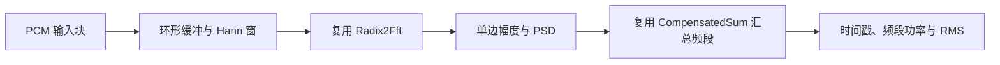

# 音频频谱数据：从需求拆解到现有资产组合

日期 2026-10-15。用户已明确输出为每帧各频段的幅度、功率数据，暂未指定采样率、声道数、延迟与频率分辨率。本文据此评估核心计算，不将需求改成输出多个分频音频流。

结论：**已有 FFT 能直接完成变换核心，已有补偿求和可用于功率累计；加上消费端的分帧、窗与归一化公式，可以组成可运行的流式频谱分析器。当前目录没有完整 STFT/音频流配方，不能把“核心可复用”说成“已有一条完整算法可以直接解决整个产品”。**

## 本次严格执行的检索范围

模型仅查看 74 项资产的 ID、类型、问题、名称等缩略索引，以及候选的契约与公开 API 文档段落；没有打开已有公共 C++ 算法头文件或算法测试实现。编译器按普通 include 机制使用资产。新写的消费端和它的组合测试可以阅读与调整。

目录版本 `0.1.0-pilot-5`。先查询整体、再拆解子问题。`streaming_audio_band_spectrum`、流式分帧、窗函数、单边 PSD、频段功率等问题 ID 当前无登记实现/配方；`discrete_fourier_transform` 命中 `numeric.radix2_fft`，有限浮点求和命中 `numeric.compensated_sum`。这是有限结构化目录检索，加上本次人工构造与验证的组合，不是自动新组合搜索，也不是任意算法空间的无解证明。完整过程见 `provenance/problem-solving/audio-spectrum.json`。

| 步骤 | 核心子问题 | 摘要检索与选择 | 连接条件 |
| --- | --- | --- | --- |
| 1. 接受 PCM 块 | 确定时间轴与数值语义 | 标准容器/输入适配；没有音频设备或编解码资产 | 固定采样率、单声道、有限归一化 double；输入块大小可变 |
| 2. 组帧并加窗 | 把无限流变成有限时段 | 消费层环形缓冲 + 预计算 periodic Hann；目录尚无已登记配方 | 长度 N、步长 H；先积累 N 个样本，以后每 H 个样本一帧；保留重叠 |
| 3. 时域转频域 | 实样本的 DFT | **复用 `numeric.radix2_fft`** | 每个样本乘窗后放进实部，虚部置零；N 为 2 的幂；每帧只做一次 FFT |
| 4. 形成有单位的单边谱 | 复谱转幅度/PSD | 公开归一化公式；现有 FFT 仅承诺复系数，不自动完成该步骤 | 前 N/2+1 点；DC/Nyquist 与内部频点使用不同倍增因子 |
| 5. 汇总 B 个频段 | PSD 的区间积分近似 | 预计算 bin 范围，**复用 `numeric.compensated_sum`** 直接累计 | 本原型是顺序、不重叠且覆盖 [0,Fs/2] 的频段；按原始 Hz 映射 |
| 6. 输出与生命周期 | 时间戳、结果所有权和资源 | 消费层回调，JSON 测试驱动 | 输出当前帧视图；下一帧覆盖；跨帧保存须由调用者复制 |



排除的候选：`numeric.real_convolution` 输出时域线性卷积，不等于频谱；`range.fenwick_sum` 是 int64 求和，不能无损接收浮点 PSD；泛型 SegmentTree 可以组合浮点聚合，但本题每帧整批生成且频段不重叠，直接遍历只需 O(K+B)，不需要构建查询树。稀疏表要求幂等操作，不适合普通求和。LU 与 Fourier 矩阵求解不匹配当前 DFT 任务，也不是已有 FFT 的合理替代。

## 假设与可调约束

示例使用 Fs=48000 Hz、单声道、N=4096、H=1024，B 可配置；这是缺省演示参数，不是用户已确认的产品指标。应用原型另限制 `1<=Fs<=1000000`、`4<=N<=2^20`、N 是 2 的幂、`1<=H<=N`，输入 double 在 [-1,1]。这些额外限制属于该消费端，不是 FFT 原始契约的全部边界。int16 等 PCM 须先按格式正确转换，不能偷偷削波。

- 频谱覆盖 0..Fs/2，即本例 0..24000 Hz。采样时已有的混叠不能靠 FFT 修复。
- bin 网格间隔 Fs/N=11.71875 Hz，单边 K=N/2+1=2049 个频点。窗时长约 85.33 ms，输出间隔 H/Fs≈21.33 ms。首帧须收集完整 N 个样本，时间戳记样本区间中点；输出频率不等于测量窗口长度。
- 网格间距不等于两个邻近音调的可分辨距离，窗主瓣、观测时长和信噪比也影响结果。补零能加密采样网格，但不会增加原始观测信息。[原作者关于补零的说明](https://www.dsprelated.com/freebooks/sasp/Zero_Padding_Interpolating_Spectral_Displays.html)
- “任意多”可解释为用户配置有限个 B 和任意严格递增的频段边界；不能解释成固定 N 下无限多独立的频率测量。B>K 时必有空 bin 频段。结果用 `bin_count=0` 明示；此时 power=0 表示没有被分配到该段的离散谱贡献，不能据此判断真实连续频段没有能量。接近边界的能量受窗泄漏与按 bin 中心划段影响。
- 原型支持任意非均匀边界；命令行驱动使用均匀边界。重叠频段会重复统计能量，需要另定义输出语义与成本；当前原型没有宣称覆盖它。
- 多声道应分别分析或明确下混策略；直接混合左右声道可能因相位相消丢失信息。本轮只验证单声道。MP3/AAC 解码、设备采集、采样率转换、线程间队列和 UI 不在现有算法资产内。

## 数值连接规则

使用周期 Hann：`w[j]=0.5-0.5*cos(2*pi*j/N)`，不是分母 N-1 的对称版本。窗口预计算，且用补偿求和计算 W1=sum(w) 和 W2=sum(w²)。[SciPy 对窗用途的说明](https://docs.scipy.org/doc/scipy/reference/generated/scipy.signal.windows.hann.html)

已有 FFT 的正变换不除以 N，因此对 `X=FFT(x*w)`：

```
c[k] = 1   (k=0 或 N/2)，其余正频点为 2
单音峰值幅度估计 A[k] = c[k] * abs(X[k]) / W1
单边 PSD[k] = c[k] * abs(X[k])^2 / (Fs * W2)
频段功率 P[b] = sum(PSD[k] * Fs/N)，k 为该段分配的 bin
频段 RMS[b] = sqrt(P[b])
```

内部频点的负频率功率已折叠进去，DC/Nyquist 不得再乘 2。PSD 的单位是归一化样本幅度²/Hz；P 是幅度²；RMS 是幅度。峰值幅度公式用于孤立、落在 bin 中心的音调估计，失配频率、多个音调、噪声等不可视为真实峰值证书。频段 RMS 与“把各 bin 幅度相加”不是同一量。[PSD 与功率谱的归一化定义](https://docs.scipy.org/doc/scipy/reference/generated/scipy.signal.periodogram.html)

不默认去掉每帧均值，因其会主动改变 DC 与低频信息。若将来要 dBFS，必须先约定参考值及零功率表示；当前不以随意 epsilon 把静音改成有限能量。

整个频域输出仍为浮点近似；PSD 总积分等于 `sum((x*w)^2)/W2`，一般不等于未加窗帧的普通均方值。只保存幅度/功率会丢失相位，不能从这些频谱统计无损恢复输入；IFFT 也不等于历史 undo。

## 组合成本与实时边界

初始化 O(N+B log N)，用于窗口、FFT plan、bin 频率和边界映射。每帧 O(N log N + N + B)，每个 bin 在频段累计中最多访问一次；不会为每个频段分别做一次 FFT，也没有 O(BN) 的重复全谱扫描。处理任意输入块另有 O(块长) 校验与写入。需输出 B 个结果时 Ω(B) 输出成本无法消除。

64-bit 本机载荷估计：FFT 根表 8N、复工作区16N、PCM 环8N、窗8N、单边频点信息约12N，频段边界/索引/输出约56B，总计约52N+56B 字节，另加常数、容器头、分配器与上游块/下游复制。N=4096 时基本载荷约208 KiB，不含设备缓冲与消费者积压；不是实测峰值。

plan、窗、输出与工作区在配置期建立，正常帧处理复用它们。FFT 摘要声明 O(1) 变换临时空间，但没有给出硬实时、无分配、无锁或最坏调度延迟证书；仅凭此不能判定音频回调安全。平均吞吐至少需跟上 Fs/H 帧/秒，是否满足具体设备 deadline 仍需实测。设备回调还应避免阻塞 I/O、内存分配和锁；命令行 JSON 输出应作为工作线程/测试行为。[PortAudio 回调约束](https://portaudio.com/docs/v19-doxydocs/writing_a_callback.html)

实例持有可变流状态，不支持同实例并发 push。push 先校验整个块，非法样本使该块完全不被消费；FFT 或回调异常没有整块回滚保证，调用者应停止当前处理并 reset/重建。回调应快速、避免重入和抛异常。reset 清空流历史与时间轴，不是 undo；没有持久化、历史分支或 redo。尾部不足下一帧的数据保留但不自动补零输出，销毁时丢弃。

## 消费端验证与运行

可编译组合在 `examples/audio_spectrum_demo.hpp`，驱动在 `examples/audio_spectrum.cpp`。它通过既有公开接口调用 FFT 与求和，尚未登记成具有生产音频契约的新公共资产。当前目录仍为74项；原型是一次可验证的应用组合。

```sh
cmake -S . -B build -DALGORITHM_ASSETS_BUILD_EXAMPLES=ON -DALGORITHM_ASSETS_BUILD_TESTS=ON
cmake --build build --target algorithm_assets_audio_spectrum algorithm_assets_audio_tests
ctest --test-dir build -R 'audio_consumer_composition|audio_scipy_reference' --output-on-failure
build/algorithm_assets_audio_spectrum.exe --demo
build/algorithm_assets_audio_spectrum.exe --stdin 48000 4096 1024 8
```

stdin 模式输入空白分隔的归一化 PCM 数值，逐块消费并逐帧输出 JSON；这不是音频文件解码器或录音设备客户端。消费者可直接构造 `Analyzer(48000,4096,1024,{0,300,2000,6000,24000})`，把获得的 PCM span 交给 push；若要保留 Frame 中的 spans，须在回调中复制。

本轮实际结果：

- `audio_consumer_composition` 通过：不同块划分逐帧一致、窗加权 Parseval 能量、静音/DC/Nyquist/落点正弦幅度、非均匀边界、B>K、非法输入原子拒绝和 reset。
- 同一 C++ 组合测试以 `-O0 -g -D_GLIBCXX_DEBUG -D_GLIBCXX_ASSERTIONS -Wall -Wextra -Wpedantic -Werror` 编译运行通过；这不是 UBSan 或硬实时验证。
- `audio_scipy_reference` 使用 NumPy 2.1.3 / SciPy 1.15.3，以 periodic Hann、`detrend=False` 的官方 periodogram 语义，60组输入共240帧通过；覆盖44100/48000 Hz、多个 N/H/B、非整 bin 音调、噪声和脉冲。本机最大 PSD 绝对差约8.67e-19，这是测试观察值，不是库通用误差上界。环境无 SciPy 时跳过此额外组，C++ 组合测试仍保留。
- 缺省双音合成流为3000 Hz、峰值0.6及9000 Hz、峰值0.2；四帧中对应频段功率约0.18和0.02，RMS约0.424264和0.141421。

没有从真实麦克风采集，没有测量设备端到端延迟、时限失约或实际进程峰值内存，也没有更改任何既有算法实现。此轮关注“摘要足以选择并调用核心资产”及其组合正确性。
