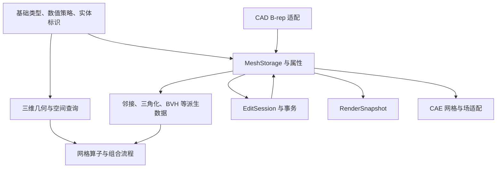

# 三维几何与网格引擎：架构调查与建议

日期：2026-10-19。用户已选择“网格处理优先，保留 CAD/CAE 扩展”。本文保留架构调查与提案，完整规划不等于已实现能力；当前首版见 [集成与验证说明](MESH3D_INTEGRATION.md)。具体产品规模、目标设备和交互频率仍需真实项目约束。

## 结论与第一阶段范围

推荐以连续数组的表面网格作为第一阶段的计算数据，按需构建邻接和编辑视图。三维几何内核提供数值类型、谓词、构造与空间查询；网格模块维护连接、属性和编辑不变量。CAD 边界表示、CAE 单元与有限元场、渲染缓冲使用各自表示，通过有版本和来源信息的转换连接。

第一阶段包含三角表面网格的查询、统计、校验和有限编辑，底层保留多边形及面角属性的表示能力。通用 NURBS 实体布尔、倒角、高阶有限元、分布式网格和渲染器本身不列入首轮实现。

## 可核查的参考与采用理由

下表记录资料中的机制；后文的数据布局和模块选择是针对本工程的建议，并非对这些软件内部实现的逐项复刻。商业 CAD/CAE 产品未公开的内部布局没有作为已知事实使用。

| 参考 | 可核查机制 | 对本工程的启发 |
| --- | --- | --- |
| [Blender Mesh](https://developer.blender.org/docs/features/objects/mesh/mesh/) | 面通过连续角点区间引用顶点/边，属性分域；有按需计算的缓存 | 主存储采用数组，反向邻接按需建立 |
| [Blender BMesh](https://developer.blender.org/docs/features/objects/mesh/bmesh/) | 顶点、边、面角、面及其连接循环，服务局部拓扑编辑，可表达非流形 | 编辑表示独立；只把可靠的局部算子开放给上层 |
| [Geometry Central](https://geometry-central.net/surface/surface_mesh/basics/) 与 [内部结构](https://geometry-central.net/surface/surface_mesh/internals/) | 区分一般 SurfaceMesh 和更紧凑的 ManifoldSurfaceMesh；后者可使用隐式 twin 索引 | 流形保证是能力条件；不要求每条路径承担一般非流形编辑的成本 |
| [Open CASCADE Modeling Data](https://occt3d.com/dev/doc/overview/html/occt_user_guides__modeling_data.html) | 分离几何与拓扑，形状共享通过引用、方向与局部位置表达 | CAD 实体及使用关系不压缩成一张三角面表 |
| [Gmsh 模型与网格](https://gmsh.info/doc/texinfo/gmsh.html#Gmsh-application-programming-interface) | 网格节点/单元归属模型实体；物理组表达额外语义 | 保存离散结果与几何来源、材料/边界分组的关联 |
| [MFEM 网格与有限元空间](https://mfem.org/mesh-format-v1.x/#finite-element-spaces) | 自由度可关联顶点、边、面、单元，不同空间有不同自由度集合 | 拓扑顶点、几何节点、求解自由度分开 |
| [VTK XML 模型](https://docs.vtk.org/en/latest/vtk_file_formats/vtkxml_file_format.html) | 单元连接、偏移和类型数组；点/单元数据各有归属 | 体网格和分析结果使用批量数组与显式域 |

Blender 的 [依赖图说明](https://developer.blender.org/docs/features/core/depsgraph/) 包含历史设计背景。本提案只采用源数据与求值结果分离、依赖失效的原则，不把其中旧版本的全部细节视为当前实现保证。

## 模块与依赖方向

- **基础层**：Point3/Vector3、变换、包围盒、单位、数值策略、强类型 ID、内存与错误约定。
- **几何查询层**：方向/侧别、重心坐标、点到图元距离、射线查询、BVH。精确谓词与近似构造分开登记。
- **网格存储层**：坐标、连接、属性、版本。不得依赖 UI、GPU、CAD 或求解器。
- **网格操作层**：校验、法向/面积、邻接、细分/简化、平滑、局部编辑，显式声明输入能力。
- **应用与适配层**：文档、命令历史、对象实例、文件读写、外部库、CAD/CAE/渲染转换。

数学小工具仍可独立 include；较大的编辑、I/O 和外部后端适合采用头文件加编译实现。不要为保持 header-only 将整个引擎变成巨型模板，也不必给每个顶点或算术操作增加虚函数。

## 核心表面网格布局

以下是字段设计说明，不是已加入公共接口的 C++ 类型。

| 数据 | 建议存储 | 约束与含义 |
| --- | --- | --- |
| 坐标 | 连续 Vec3d 数组 | 每顶点3个 double；非有限值拒绝，坐标系与长度单位属于模型约定 |
| 面范围 | `face_offsets[F+1]` | 从0开始单调递增，末项等于角点总数 C；每面先支持单个边界环 |
| 面角顶点 | `corner_vertices[C]` | 每角点引用一个顶点，相邻角点确定有向边；索引必须有效 |
| 显式边（可选） | `edge_vertices[E][2]`、`corner_edges[C]` | 保留独立线边及同端点的不同拓扑边；角点所指边必须与该角点及下一角点端点一致 |
| 属性 | 按 Vertex/Edge/Face/Corner 分域的独立数组 | 长度与对应域一致；按需分配，不把所有字段塞进一个大顶点结构 |
| 持久标识（按需） | 域内 ID 数组与 ID 到稠密索引的映射 | 与当前数组索引分离；删除、重排及文件往返有明确映射 |

为方便 Eigen 对接，坐标默认选择紧凑 xyz 三元组数组，而不是不加区分地拆成 x/y/z 三个数组。整体采用“坐标、连接、属性分别连续”的布局；具体核函数需要另一种布局时使用显式工作区，并测量转换成本。

三角网格可直接按每3个角点遍历，提供只读三元访问视图；不必再复制一份三角索引。任意平面凹多边形不能用简单扇形三角化代替可靠处理；非平面多边形要定义投影/误差策略。带孔面第一阶段明确不支持单面表达，不能在导入时悄悄丢弃内环。

默认从面角派生的边可以按无向端点对合并，此时必须声明“同一端点对代表同一拓扑边”。需要多重拓扑边或独立线边的输入应使用显式边表示；这类数据不能通过端点对去重来无损重建。

### 必须保留面角域

同一个几何顶点在不同面上可有不同 UV、法向或其他不连续量。UV 和分裂法向优先放 Corner 域，材质/区域放 Face 域，约束或特征标记按实际域存储。

渲染导出时，按位置、UV、法向和材质需求组合拆分 GPU 顶点，并保存渲染三角形到原 Face、三角形角到原 Corner 的映射。GPU 顶点重复不意味着几何拓扑顶点也应该被永久拆开。

## 邻接：保存必要事实，按需构建反向关系

第一阶段使用清楚的常量成本面遍历；需要时构建顶点到角点、边到角点等 offsets+indices 的 CSR 关系。面到角点已有范围，无需再建一份。角点归属面可以缓存，或在面遍历中直接知道；不要默认维护全部两两关系。

派生边和邻接的构建成本必须记录：排序归并路径一般 O(C log C)，哈希路径一般为期望 O(C)，后者不应写成无条件最坏线性。两者都需要临时空间，不能只统计最终 CSR。

所有可共享缓存必须依赖相应数据版本，不能绕过可变接口直接写坐标或连接。库内算法优先接收所需的只读视图，而不是获得可以任意修改所有属性的引擎对象。

## 编辑表示：第一版采用经过验证的流形半边视图

表面网格的通用存储可以保留非流形输入，但不保证每个算子都可处理它。基础校验分别报告结构合法、退化、边流形、顶点流形、可定向、闭合和自交状态。边关联面数不超过2不等于顶点流形；还需检查顶点 link，识别 bow-tie 等情况。

推荐先为整体验证通过的可定向流形对象建立索引化半边 EditSession，支持三角形的有限 split/flip/collapse 等操作；涉及的几何、拓扑与属性条件由具体算子约束。边界半边与真实面分开计数，禁止把边界循环当作有效面参与面积或求解。

只有非流形局部编辑成为实际需求时，再考虑 radial/sibling 结构。BMesh 的循环能启发这一扩展，但第一版不必复刻其全部编辑框架。

批量算法直接处理连续存储；一组局部编辑在同一个会话内完成，最后提交紧凑结果和重编号映射。不要每个单步操作都在数组与编辑结构之间来回转换。会话构建和压缩提交可能是 O(V+E+C)，必须和局部算子成本分别记账。

### 编辑不变量与失败

- 操作先检查对象、版本、邻域条件和属性策略；失败不发布半更新的权威数据。
- flip 必须检查邻接三角形、边界、重复边等条件；collapse 除拓扑 link 条件外，还需考虑翻面、质量、特征和接缝约束。
- 局部检查不自动证明全局无自交。若未执行全局验证，应将结果状态标成未验证，而不能沿用旧证书。
- 属性转移由明确策略决定：连续场插值、类别字段选择/冲突处理、法向重算、接缝保持；材料编号不能取平均。

## 标识、撤销与并发

区分三种身份：当前缓冲中的稠密索引、带 mesh/domain/generation 的运行期句柄、文件/业务使用的持久逻辑 ID。句柄可使用索引加代数，但代数回绕、对象归属和生命周期都需要检查；仅有一个裸整数无法防止跨对象误用。

压缩后通过映射更新内部索引；删除立即使旧句柄失效。undo 可以恢复逻辑实体，但旧运行期句柄是否复活必须由契约决定，建议不自动复活。一个旧句柄不能因为槽位重用就指向新元素。

编辑事务记录实际修改的数据与属性前镜像，再实现 undo/redo；拓扑算子在数学上有逆操作不等于其属性、ID、选择和缓存也可自动恢复。大批操作用缓冲快照或分块写时复制，少量局部操作用增量记录。首版先采用单写者，读者使用固定版本的只读快照，不在每个顶点上加锁。

任务应记录输入版本，在只读快照上计算；提交时检查输入是否仍匹配。若已经过期，丢弃或显式重新计算，不将旧法向/BVH 写回新几何。变更历史与业务参数依赖图属于应用层，不强迫所有批量算法拥有完整撤销系统。

## 版本与缓存的具体失效规则

建议至少区分 topology_revision、geometry_revision、attribute_revision、instance_transform_revision；属性版本可进一步按层区分。

| 变化 | 可保留 | 失效或更新 |
| --- | --- | --- |
| 只改位置 | 连接、邻接 | 法向、面积、质量矩阵、依赖坐标的 Laplacian、BVH 等 |
| 只改 UV/颜色 | 邻接、几何 BVH | 对应渲染属性缓冲；依赖该属性的计算 |
| 改拓扑 | 只有确认不受影响且完成映射的数据 | 邻接、三角化、空间索引、编辑映射及相关属性 |
| 只改对象变换 | 对象局部空间网格 | 世界空间包围盒、实例加速结构和相关查询变换 |

BVH 在仅改位置时可以尝试 refit，但大变形后可能需要重建；两者均要测量。缓存键还需包含算法参数、数值/精度策略和后端版本。缓存设容量预算与淘汰规则，不永久保留所有邻接、编辑副本和渲染副本。

## 数值、空间和对象变换

几何计算默认 double，渲染可生成 float 局部坐标并保留高精度原点；不能把显示精度当作计算精度。模型显式携带单位、坐标约定和容差策略。角度、长度和面积的阈值不同，不能用同一个全局 EPS。

方向、相交分类等应定义谓词保证；需要精确符号时采用经过验证的过滤/自适应方法。精确谓词不自动产生精确交点，double 输入之前的测量或转换误差也不会因精确计算而消失。

现有二维整数坐标 ±10⁹ 的 int64 精确性边界不能直接沿用到三维：orientation3d 涉及三重积，必须重新推导坐标界与中间值位宽，或使用更宽/多精度与过滤方法。把二维 Point 增加一个 z 字段不足以建立三维内核的数值契约。

实例保存资源引用与变换，几何数据可共享。非均匀缩放下距离度量、法向逆转置、反射后的绕向需明确处理；一般仿射变换后的最近点查询不能仅在局部求欧氏最近点再直接变换回来。未知/退化/无法认证状态需显式返回。

对开口、自交或方向不一致的网格，不默认提供“可靠实体内外”“物理体积”或“有符号距离”。这些操作需要各自的前提或另一个明确的定义。

## CAD 的扩展边界

未来保留几何曲线/曲面与 Vertex—Edge—EdgeUse—Wire—Face—Shell—Solid 等关系；EdgeUse 表达边在某一面/环中的方向和使用情况。曲面参数域、修剪环和参数曲线有独立信息，不能只保留三维端点。

本提案建议 CAD 网格化结果保存源 Body/Face/Edge 版本及标识、参数坐标或投影关联、离散误差与法向策略。CAD 面与网格面应是显式关联，不能复用同一套 Face ID。重网格后重新建立映射；直接修改离散网格后，标明它已不再是原 CAD 的有效离散结果。

邻近坐标不等于同一拓扑实体，焊接/缝合应是有容差、报告和历史的显式操作。对 CAD 操作导致的面分裂/合并，来源关系可以多对多；一个 UUID 本身不能解决拓扑命名问题。第一阶段仅保留这些边界，完整 B-rep、布尔及修复后续优先评估成熟内核。

## CAE 的扩展边界

未来的 VolumeMesh 使用 CellType、cell_offsets、cell_connectivity，以及按需构建的面/边关联。四面体、六面体、棱柱等保持明确的本地节点顺序与方向规则；多面体还需显式面与有向面使用关系。体网格表皮是导出视图，不是体网格本身。

拓扑顶点、曲边/曲面几何节点、有限元自由度、积分点数据分别建模。解场包含所用空间、阶次、分量、基函数约定和时间步，而不是一律塞到 vertex_data。高阶几何还需独立的参考单元到物理单元映射。

材料、边界条件和接触面使用带语义的实体集合；重网格后必须显式转移或重新绑定。将应力简单按顶点线性插值不等于守恒或正确的有限元投影。AMR 的父子关系、悬挂节点约束和分区 ghost 数据留作后续模块，不进入首版普通表面网格。

## 内存载荷估算

以下为提案字段的算术估算，不是实测进程峰值或性能最优证明。假设 V=1,000,000、F=2,000,000、C=6,000,000；索引 uint32、偏移 uint64、坐标 double，示例 E=3,000,000。

| 可选组成 | 公式 | 十进制 MB（约） |
| --- | --- | --- |
| 坐标 | 24V | 24 |
| 面偏移 | 8(F+1) | 16 |
| 面角顶点 | 4C | 24 |
| 上述三项基础载荷 | 24V+8(F+1)+4C | 64 |
| 显式边端点与角点边索引 | 8E+4C | 48 |
| 边到角点 CSR | 8(E+1)+4C | 48 |
| 仅顶点和面各一个64位逻辑 ID | 8(V+F) | 24 |
| 每面角 float2 UV | 8C | 48 |
| 每面角 float3 法向 | 12C | 72 |

基础64 MB约61.0 MiB；需要全部上述数据时已经远高于它。尚未计入逆映射、其他属性、BVH、编辑会话、撤销历史、矩阵、构建临时空间和渲染上传缓冲。纯三角形紧凑布局可省去显式面偏移，基础载荷降至24V+12F=48 MB；是否值得采用独立变体应由真实负载决定。

字段位宽是实现选择：uint32 路径对每个索引域检查上界，超界拒绝；需要时再添加明确的64位实现变体。偏移数组的总连接数溢出也必须检查，不能静默截断。

## 可选依赖与现有资产的角色

- 既有二维几何只在可证明的降维条件下复用；不能将二维 orientation 或凸裁剪直接作为通用三维算法。静态 CSR、补偿求和等可作为特定流程组件，但需检查规模、精度及额外复制成本。
- Eigen 可承担矩阵与求解；libigl 可作为具体网格算子的后端或独立对照。记录版本和使用模块，并明确复制/视图、布局与所有权。
- CGAL 的谓词或几何算法、OCCT 的 CAD 能力放在可选适配层，保证差异不应通过隐式降级隐藏。精确数到 double 的转换须标明信息损失。
- 不直接绑定所有第三方对象为本工程的唯一公共数据模型，也不为替换后端包装每个标量运算。
- 本调查参考公开架构，不复制 Blender 源码。Blender 的 [GPL 许可](https://www.blender.org/about/license/)、CGAL 的 [分包许可](https://www.cgal.org/license.html) 与其他后端均需按实际使用版本单独核对；封装不会改变上游条款。

Eigen 映射须核对标量类型、行列布局、stride、对齐和借用生命周期；不能以 reinterpret_cast 把不兼容的数组对象当成矩阵元素。公开格式的导入导出应列出支持的属性域与精度，并报告被丢弃/近似转换的信息。原生存档记录格式版本、单位、逻辑 ID 和属性语义；运行期句柄与缓存不直接作为持久格式。

## 建议实施次序与验收

| 阶段 | 交付 | 需要通过的检查 |
| --- | --- | --- |
| 1. 存储与只读查询 | Point3/Vector3、三角网格与角点属性、校验报告、邻接、面积/法向、AABB/最近点基础 | 空/孤立/重复/退化、开边界、非流形边与bow-tie、绕向；结构和能力分类准确 |
| 2. 一个真实计算流程 | Eigen 适配、选定的 Laplacian/质量矩阵、带显式边界条件的平滑或求解 | 常量场、不变量、边界与零空间、libigl 独立对照；单位/缩放和退化策略明确 |
| 3. 有限编辑与历史 | 流形半边会话、split/flip/collapse 的有限子集、属性转移、事务、undo/redo | 随机操作序列、失败原子性、旧句柄拒绝、接缝/材质、压缩映射和回放 |
| 4. 空间查询与显示互通 | BVH、渲染快照、PLY/其他选定格式与来源映射 | 与朴素查询对照，位置变更不返回旧缓存，UV接缝及挑选映射正确 |
| 5. CAD/CAE 跨表示案例 | 一个 CAD 面离散案例与一个四面体/场案例 | 方向、边界组、误差/来源、字段转移和版本失效可追踪 |

阶段顺序可因真实项目调整；没有预先承诺具体吞吐、峰值或多线程加速比。基准应覆盖只读批处理、连续局部编辑、位置变化与属性变化，分别记录冷/热缓存、构建/查询/提交/转换、实际峰值和保留容量。可先用10万、100万、1000万级三角形作为探测规模，而不把它们当成已确认产品指标。

首个工程里程碑建议是“导入网格→校验与保留角点属性→邻接与几何量→一次带边界条件的求解→导出并复查”。当前首版资产及剩余边界见 [三维集成说明](MESH3D_INTEGRATION.md)，不能把整个架构规划都视为已完成。
